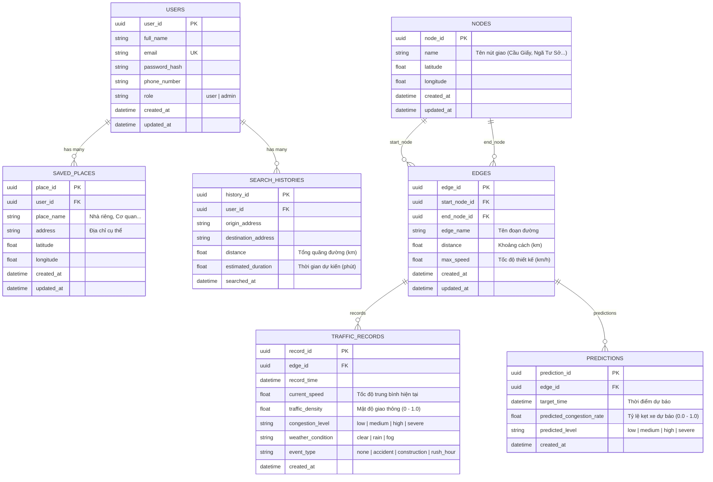
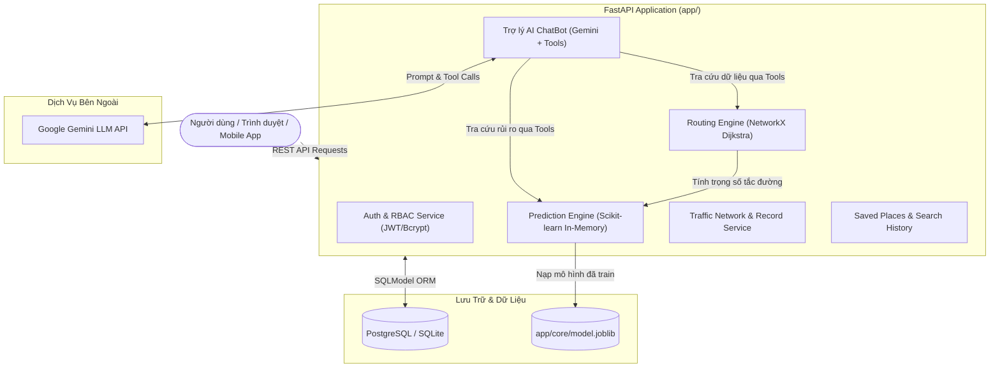

# 🚦 Hệ Thống Backend Dự Báo Kẹt Xe & Trợ Lý Giao Thông AI Hà Nội (FastAPI)

> **Dự án Đồ Án Chuyên Ngành / Tốt Nghiệp**: Hệ thống API Backend thông minh phục vụ người tham gia giao thông tại TP. Hà Nội, hỗ trợ dự đoán trước nguy cơ kẹt xe trên các cung đường huyết mạch, tự động đề xuất lộ trình tối ưu nhằm giảm thiểu ùn tắc, và cung cấp Trợ lý ảo AI ChatBot tiếng Việt hỏi đáp tình hình giao thông theo thời gian thực.

---

## 📌 Mục Lục

- [1. Giới Thiệu & Điểm Nổi Bật](#1-giới-thiệu--điểm-nổi-bật)
- [2. Công Nghệ Sử Dụng (Tech Stack)](#2-công-nghệ-sử-dụng-tech-stack)
- [3. Kiến Trúc & Mô Hình Dữ Liệu (ERD)](#3-kiến-trúc--mô-hình-dữ-liệu-erd)
- [4. Cấu Trúc Thư Mục Dự Án](#4-cấu-trúc-thư-mục-dự-án)
- [5. Hướng Dẫn Cài Đặt & Khởi Chạy](#5-hướng-dẫn-cài-đặt--khởi-chạy)
  - [Cách 1: Chạy cục bộ bằng `uv` (Khuyên dùng khi phát triển)](#cách-1-chạy-cục-bộ-bằng-uv-khuyên-dùng-khi-phát-triển)
  - [Cách 2: Chạy bằng `Docker` & `Docker Compose`](#cách-2-chạy-bằng-docker--docker-compose)
- [6. Khởi Tạo Dữ Liệu Mẫu & Huấn Luyện AI](#6-khởi-tạo-dữ-liệu-mẫu--huấn-luyện-ai)
- [7. Danh Mục API Endpoints](#7-danh-mục-api-endpoints)
- [8. Trợ Lý Giao Thông AI ChatBot (Google Gemini)](#8-trợ-lý-giao-thông-ai-chatbot-google-gemini)
- [9. Giới Hạn Tần Suất Yêu Cầu (Rate Limiting - SlowAPI)](#9-giới-hạn-tần-suất-yêu-cầu-rate-limiting---slowapi)
- [10. Kiểm Thử & Kiểm Chuẩn Code (TDD & Ruff)](#10-kiểm-thử--kiểm-chuẩn-code-tdd--ruff)
- [11. Bản Quyền & Tác Giả](#11-bản-quyền--tác-giả)

---

## 1. Giới Thiệu & Điểm Nổi Bật

Tại các đô thị lớn như **TP. Hà Nội**, ùn tắc giao thông vào giờ cao điểm là bài toán nhức nhối gây lãng phí thời gian và nhiên liệu. Dự án này xây dựng một hệ thống backend API toàn diện với các giải pháp:

1. **Dự báo trước nguy cơ tắc đường**: Sử dụng mô hình Machine Learning phân tích các yếu tố thời gian (giờ trong ngày, ngày trong tuần, cuối tuần), thời tiết (mưa, nắng), và sự kiện để dự báo xác suất và mức độ kẹt xe trên từng tuyến đường.
2. **Tìm đường thông minh (Intelligent Routing)**: Áp dụng thuật toán đồ thị **Dijkstra** trên mạng lưới giao thông Hà Nội với trọng số thích ứng động (Dynamic Congestion Weight). Lộ trình đề xuất không chỉ tìm đường ngắn nhất về khoảng cách vật lý mà còn chủ động né tránh các nút giao đang có rủi ro ùn tắc cao.
3. **Trợ lý AI ChatBot tương tác tự nhiên**: Tích hợp mô hình ngôn ngữ lớn **Google Gemini** với cơ chế **Function Calling / Tool Calling**, cho phép người dùng hỏi đáp tự nhiên bằng tiếng Việt (Ví dụ: *"Đường từ Cầu Giấy về Ngã Tư Sở có tắc không?", "Tìm đường nhanh nhất từ Kim Mã về Bờ Hồ"*). Có cơ chế phản hồi Heuristic thông minh dự phòng khi chưa cấu hình Gemini API Key.
4. **Phân quyền người dùng chặt chẽ (RBAC)**: Phân chia 2 vai trò `user` (tra cứu, lưu địa điểm yêu thích, xem lịch sử) và `admin` (quản trị mạng lưới đường, xem thống kê tra cứu toàn hệ thống, kích hoạt huấn luyện lại mô hình ML).

---

## 2. Công Nghệ Sử Dụng (Tech Stack)

| Thành phần | Công nghệ | Chi tiết sử dụng |
| :--- | :--- | :--- |
| **Framework** | **FastAPI 0.162+** | Framework Python hiện đại, hiệu năng cao, tự động sinh tài liệu OpenAPI / Swagger UI |
| **Gói & Môi trường** | **Astral uv** | Trình quản lý gói và môi trường ảo Python tốc độ cao (nhanh gấp 10-100x pip) |
| **Kiểm chuẩn Code** | **Ruff** | Linter và Code Formatter theo quy chuẩn Python hiện đại (Python >= 3.12) |
| **Cơ sở dữ liệu** | **SQLModel / SQLAlchemy** | ORM kết hợp Pydantic & SQLAlchemy, tương thích cả PostgreSQL (Supabase/Docker) lẫn SQLite |
| **Bảo mật & Auth** | **PyJWT & Pwdlib (Bcrypt)** | Xác thực stateless JWT Tokens, mã hóa mật khẩu an toàn |
| **Machine Learning** | **Scikit-learn & Joblib** | Mô hình `RandomForestRegressor`, nạp in-memory khi server khởi động (Inference < 2ms) |
| **Thuật toán Đồ thị** | **NetworkX** | Xây dựng đồ thị có hướng (DiGraph) và tìm đường tối ưu động theo trọng số chi phí thời gian thực |
| **Trí tuệ nhân tạo** | **Google GenAI SDK** | Mô hình `gemini-2.5-flash` hỗ trợ Tool Calling trực tiếp vào cơ sở dữ liệu hệ thống |
| **Container hóa** | **Docker & Docker Compose** | Dockerfile tối ưu multi-stage layer cache, docker-compose tích hợp sẵn PostgreSQL 16 Alpine |

---

## 3. Kiến Trúc & Mô Hình Dữ Liệu (ERD)

### Sơ Đồ Thực Thể Quan Hệ (ERD)

Cơ sở dữ liệu được chuẩn hóa gồm 7 bảng với khóa chính và khóa ngoại sử dụng UUID:



### Kiến Trúc Tổng Thể



---

## 4. Cấu Trúc Thư Mục Dự Án

```text
TRAFFIC_SYSTEM_BE/
├── app/
│   ├── api/
│   │   └── v1/
│   │       ├── endpoints/
│   │       │   ├── admin.py             # API Admin (retrain ML, thống kê tìm kiếm)
│   │       │   ├── auth.py              # Đăng ký, đăng nhập, thông tin tài khoản
│   │       │   ├── chatbot.py           # Trợ lý giao thông AI ChatBot
│   │       │   ├── predictions.py       # API suy luận dự báo tắc đường
│   │       │   ├── routing.py           # API tìm đường tối ưu né kẹt xe
│   │       │   ├── saved_places.py      # Quản lý địa điểm yêu thích cá nhân
│   │       │   ├── search_histories.py  # Lịch sử tìm kiếm & thống kê
│   │       │   ├── traffic_network.py   # Quản lý nút giao (Nodes) & đoạn đường (Edges)
│   │       │   └── traffic_records.py   # Cập nhật & tra cứu trạng thái giao thông
│   │       └── router.py                # Tổng hợp Router v1
│   ├── core/
│   │   ├── config.py                    # Cấu hình Pydantic Settings & biến môi trường
│   │   ├── database.py                  # Khởi tạo Engine SQLAlchemy & Session SQLModel
│   │   ├── exceptions.py                # Định nghĩa mã lỗi tùy chỉnh
│   │   ├── handlers.py                  # Global Exception Handlers
│   │   ├── model.joblib                 # Trọng số mô hình ML RandomForest đã huấn luyện
│   │   ├── response.py                  # Chuẩn hóa định dạng JSON Response trả về
│   │   └── security.py                  # Tiện ích băm mật khẩu & ký/giải mã JWT
│   ├── middlewares/
│   │   └── middleware.py                # Middleware xử lý CORS và logging request
│   ├── models/                          # 7 SQLModels chuẩn theo ERD
│   │   ├── edge.py
│   │   ├── node.py
│   │   ├── prediction.py
│   │   ├── saved_place.py
│   │   ├── search_history.py
│   │   ├── traffic_record.py
│   │   └── user.py
│   ├── schemas/                         # Pydantic Schemas validate Request/Response
│   ├── services/                        # Business Logic xử lý nghiệp vụ
│   │   ├── auth_service.py
│   │   ├── chatbot_service.py           # Tích hợp Gemini Tool Calling & Heuristic Fallback
│   │   ├── prediction_service.py        # Suy luận ML & thuật toán dự báo
│   │   ├── routing_service.py           # NetworkX Dijkstra tính toán lộ trình tối ưu
│   │   ├── traffic_record_service.py
│   │   ├── traffic_service.py           # Name Resolver tìm kiếm mờ địa danh Hà Nội
│   │   └── user_data_service.py
│   └── main.py                          # Điểm vào chính ứng dụng FastAPI (Lifespan)
├── data/
│   └── synthetic_traffic_dataset.csv    # Bộ dữ liệu 12,960 bản ghi giao thông mẫu Hà Nội
├── docs/                                # Tài liệu thiết kế Design Spec & Kế hoạch TDD
├── scripts/
│   ├── generate_synthetic_traffic.py    # Script sinh số liệu giao thông giả lập Hà Nội
│   ├── seed_hanoi_network.py            # Seed 10 nút giao & 18 tuyến đường Hà Nội
│   └── train_prediction_model.py        # Huấn luyện mô hình RandomForest & lưu joblib
├── tests/                               # 10 bộ Unit & Integration Tests (100% Green)
├── .dockerignore
├── .env.example                         # File mẫu cấu hình biến môi trường
├── .gitignore
├── docker-compose.yml                   # Cụm Docker Compose (API + PostgreSQL 16)
├── Dockerfile                           # Dockerfile tối ưu hóa với uv
├── pyproject.toml                       # Định nghĩa dependencies & cấu hình pytest/ruff
├── README.md
└── uv.lock                              # Khóa phiên bản gói cài đặt chính xác
```

---

## 5. Hướng Dẫn Cài Đặt & Khởi Chạy

### Cách 1: Chạy cục bộ bằng `uv` (Khuyên dùng khi phát triển)

Dự án sử dụng trình quản lý gói thế hệ mới [Astral uv](https://github.com/astral-sh/uv).

#### Bước 1: Cài đặt `uv` (nếu máy chưa có)
- **Linux/macOS**:
  ```bash
  curl -LsSf https://astral.sh/uv/install.sh | sh
  ```
- **Windows (PowerShell)**:
  ```powershell
  powershell -ExecutionPolicy ByPass -c "irm https://astral.sh/uv/install.ps1 | iex"
  ```

#### Bước 2: Clone repository và cài đặt dependencies
```bash
git clone https://github.com/<your-username>/TRAFFIC_SYSTEM_BE.git
cd TRAFFIC_SYSTEM_BE

# Tự động tạo virtualenv .venv và cài đặt trọn bộ thư viện
uv sync
```

#### Bước 3: Cấu hình biến môi trường
Tạo file `.env` từ file mẫu `.env.example`:
```bash
cp .env.example .env
```
*(Nếu muốn sử dụng AI ChatBot với Gemini, bạn mở file `.env` và điền `GEMINI_API_KEY="your-api-key"`. Nếu không điền, hệ thống sẽ tự động dùng chế độ Heuristic phản hồi dự phòng)*.

#### Bước 4: Khởi tạo dữ liệu mẫu Hà Nội & Model AI
```bash
# 1. Khởi tạo 10 nút giao và 18 cung đường Hà Nội
uv run python scripts/seed_hanoi_network.py

# 2. (Tùy chọn) Sinh thêm dữ liệu lịch sử đo đạc giao thông
uv run python scripts/generate_synthetic_traffic.py

# 3. (Tùy chọn) Huấn luyện lại mô hình ML dự báo tắc đường
uv run python scripts/train_prediction_model.py
```

#### Bước 5: Khởi chạy máy chủ FastAPI
```bash
uv run uvicorn app.main:app --host 127.0.0.1 --port 8000 --reload
```
- 🌐 Truy cập Swagger UI trực quan: [http://127.0.0.1:8000/docs](http://127.0.0.1:8000/docs)
- 🌐 ReDoc API: [http://127.0.0.1:8000/redoc](http://127.0.0.1:8000/redoc)
- 🩺 Kiểm tra trạng thái hệ thống: [http://127.0.0.1:8000/api/health](http://127.0.0.1:8000/api/health)

---

### Cách 2: Chạy bằng `Docker` & `Docker Compose`

Dự án đã đóng gói sẵn `Dockerfile` và `docker-compose.yml` tích hợp sẵn cơ sở dữ liệu PostgreSQL 16 Alpine.

#### Bước 1: Khởi động hệ thống
```bash
docker compose up -d --build
```
Lệnh trên sẽ:
1. Tạo container `traffic_system_db` chạy PostgreSQL 16 với cơ chế healthcheck.
2. Build container `traffic_system_api` cài đặt sạch mọi dependencies qua `uv`.
3. Tự động kết nối database và khởi tạo sẵn 7 bảng trong PostgreSQL.

#### Bước 2: Khởi tạo dữ liệu mẫu Hà Nội vào Docker DB
```bash
# Seed dữ liệu mạng lưới đường Hà Nội vào container
docker compose exec api uv run python scripts/seed_hanoi_network.py
```

#### Bước 3: Theo dõi logs & Quản lý
```bash
# Xem logs thời gian thực của FastAPI API
docker compose logs -f api

# Dừng hệ thống khi không sử dụng
docker compose down
```

---

## 6. Khởi Tạo Dữ Liệu Mẫu & Huấn Luyện AI

Mạng lưới đường Hà Nội được dựng sẵn trong `scripts/seed_hanoi_network.py` bao gồm các nút giao thực tế:
- **10 Nút giao trọng điểm**: `Ngã Tư Sở`, `Cầu Giấy`, `Kim Mã`, `Hoàn Kiếm (Bờ Hồ)`, `Giải Phóng`, `Vành Đai 3 - Nguyễn Trãi`, `Nguyễn Chí Thanh`, `Trần Duy Hưng`, `Hồ Tây (Lạc Long Quân)`, `Bến xe Mỹ Đình`.
- **18 Cung đường huyết mạch**: Các tuyến kết nối hai chiều có đầy đủ khoảng cách (km) và tốc độ thiết kế (km/h).
- **Bộ dữ liệu 12,960 bản ghi giả lập** (`data/synthetic_traffic_dataset.csv`): Mô phỏng tốc độ di chuyển, mật độ phương tiện và cấp độ tắc đường thực tế theo các khung giờ cao điểm (7h - 9h sáng, 17h - 19h chiều) và điều kiện thời tiết (mưa, ngập, sự cố).
- **Mô hình Machine Learning**: Thuật toán `RandomForestRegressor` học các quy luật kẹt xe theo thời gian thực và xuất ra `app/core/model.joblib`.

---

## 7. Danh Mục API Endpoints

Tất cả phản hồi từ API đều được chuẩn hóa theo cấu trúc JSON:
```json
{
  "success": true,
  "message": "Thông điệp phản hồi",
  "data": { ... }
}
```

### 1. Xác thực & Tài khoản (`/api/v1/auth`)
- `POST /api/v1/auth/register`: Đăng ký tài khoản người dùng mới (Mặc định vai trò `user`).
- `POST /api/v1/auth/login`: Đăng nhập bằng Email/Password, nhận JWT Bearer Token.
- `GET /api/v1/auth/me`: Lấy thông tin tài khoản hiện tại (Yêu cầu Token).

### 2. Mạng lưới giao thông (`/api/v1/traffic-network`)
- `GET /api/v1/traffic-network/nodes`: Danh sách các nút giao thông kèm tọa độ (Lat/Lng).
- `POST /api/v1/traffic-network/nodes`: Thêm nút giao mới (Chỉ dành cho `admin`).
- `GET /api/v1/traffic-network/edges`: Danh sách các cung đường kết nối giữa các nút giao.
- `POST /api/v1/traffic-network/edges`: Thêm cung đường mới (Chỉ dành cho `admin`).

### 3. Ghi nhận giao thông thời gian thực (`/api/v1/traffic-records`)
- `POST /api/v1/traffic-records/`: Ghi nhận trạng thái lưu thông (Tốc độ, mật độ, thời tiết, sự kiện).
- `GET /api/v1/traffic-records/latest`: Lấy thông tin giao thông mới nhất trên toàn mạng lưới.

### 4. Dự báo nguy cơ tắc đường (`/api/v1/predictions`)
- `POST /api/v1/predictions/forecast`: Dự báo tỷ lệ tắc đường (0.0 - 1.0) và cấp độ kẹt xe (`low`, `medium`, `high`, `severe`) tại một thời điểm tương lai cho đoạn đường cụ thể.
- `GET /api/v1/predictions/history`: Xem lịch sử các dự đoán đã lưu trữ.

### 5. Định tuyến đường thông minh (`/api/v1/routing`)
- `POST /api/v1/routing/directions`: Tìm lộ trình di chuyển tối ưu giữa 2 địa điểm tại Hà Nội (hỗ trợ nhập theo Tên nút giao hoặc Tìm kiếm mờ thông minh).
  - Thuật toán tự động tính trọng số chi phí dựa trên khoảng cách và rủi ro tắc đường do AI dự báo.
  - Tự động lưu lịch sử tìm kiếm vào bảng `SearchHistories`.

### 6. Địa điểm yêu thích & Lịch sử (`/api/v1/saved-places` & `/api/v1/search-histories`)
- `POST /api/v1/saved-places`: Lưu địa điểm cá nhân (Nhà, Cơ quan, Điểm hẹn...).
- `GET /api/v1/saved-places`: Danh sách địa điểm yêu thích của người dùng đang đăng nhập.
- `DELETE /api/v1/saved-places/{place_id}`: Xóa địa điểm yêu thích.
- `GET /api/v1/search-histories/me`: Lịch sử các lộ trình người dùng đã từng tra cứu.
- `GET /api/v1/search-histories/stats`: Thống kê các điểm đến và cung đường được tra cứu nhiều nhất (Chỉ dành cho `admin`).

### 7. Trợ lý Giao thông AI ChatBot (`/api/v1/chatbot`)
- `POST /api/v1/chatbot/chat`: Gửi câu hỏi tự nhiên bằng tiếng Việt cho trợ lý giao thông. Trợ lý tự động gọi các tool hệ thống để tra cứu đường đi và đưa ra lời khuyên thực tế.

### 8. Quản trị & Retrain Model (`/api/v1/admin`)
- `POST /api/v1/admin/retrain-model`: Kích hoạt tiến trình chạy ngầm (Background Task) để huấn luyện lại mô hình ML khi có thêm dữ liệu đo đạc mới (Chỉ dành cho `admin`).

---

## 8. Trợ Lý Giao Thông AI ChatBot (Google Gemini)

ChatBot trong hệ thống được thiết kế theo kiến trúc **Agentic Tool Calling**:
1. Tiếp nhận câu hỏi tự nhiên từ người dùng bằng tiếng Việt.
2. AI tự động nhận diện ý định và kích hoạt các công cụ tương ứng:
   - `get_traffic_overview`: Lấy tình hình tắc đường chung tại Hà Nội.
   - `predict_congestion_on_road`: Tra cứu dự báo kẹt xe trên đoạn đường chỉ định.
   - `find_optimal_route`: Gọi thuật toán tìm lộ trình né tắc đường tối ưu.
   - `get_user_saved_places`: Lấy danh sách địa điểm yêu thích của người dùng (khi người dùng nói *"chỉ đường về nhà"*).
3. **Cơ chế Fallback thông minh**: Nếu người dùng chưa cấu hình `GEMINI_API_KEY`, ChatBot vẫn hoạt động trơn tru bằng bộ phân tích cú pháp Heuristic nội bộ, phân tích từ khóa và tra cứu dữ liệu chính xác để trả về câu trả lời mạch lạc, không làm gián đoạn trải nghiệm người dùng.

---

## 9. Giới Hạn Tần Suất Yêu Cầu (Rate Limiting - SlowAPI)

Hệ thống tích hợp giới hạn tần suất yêu cầu (**Rate Limiting**) bảo vệ tài nguyên và dịch vụ AI theo địa chỉ IP thông qua thư viện `slowapi`:

| Endpoint | Giới hạn | Mục đích bảo vệ |
|---|---|---|
| `POST /api/v1/auth/login` | **5 yêu cầu / phút** | Chống tấn công dò mật khẩu (brute-force) |
| `POST /api/v1/auth/register` | **5 yêu cầu / phút** | Chống spam đăng ký tài khoản rác |
| `POST /api/v1/chatbot/chat` | **10 yêu cầu / phút** | Tránh lãng phí quota Google Gemini AI |
| `POST /api/v1/admin/retrain-model` | **2 yêu cầu / phút** | Bảo vệ CPU/RAM khỏi khởi chạy train model ồ ạt |
| `POST /api/v1/routing/directions` | **20 yêu cầu / phút** | Tối ưu tài nguyên thuật toán Dijkstra & ML |
| **Các API còn lại** | **60 yêu cầu / phút** | Giới hạn mặc định toàn hệ thống |

Khi vượt quá giới hạn, server trả về mã **HTTP 429 Too Many Requests** theo chuẩn `StandardResponse`:
```json
{
  "status_code": 429,
  "message": "Quá nhiều yêu cầu. Vui lòng thử lại sau!",
  "error": "RATE_LIMIT_EXCEEDED",
  "data": null,
  "path": "/api/v1/auth/login",
  "timestamp": "2026-11-09T07:45:00.000000+00:00"
}
```
Header phản hồi bao gồm `Retry-After: 60` cho biết số giây cần chờ trước khi thực hiện request tiếp theo.

---

## 10. Kiểm Thử & Kiểm Chuẩn Code (TDD & Ruff)

Dự án được xây dựng nghiêm ngặt theo phương pháp **Test-Driven Development (TDD)** với 11 bộ kiểm thử bao phủ toàn diện:

```bash
# Chạy toàn bộ test suites
uv run pytest -v
```

Kiểm tra định dạng và chất lượng code với **Ruff**:
```bash
# Kiểm tra linter
uv run ruff check .

# Tự động định dạng code
uv run ruff format .
```

---

## 11. Bản Quyền & Tác Giả

- **Dự án**: Hệ thống Backend Dự báo Kẹt xe & Tối ưu Giao thông Hà Nội (FastAPI + AI).
- **Mục đích**: Đồ án học tập, nghiên cứu và ứng dụng công nghệ giao thông thông minh (ITS - Intelligent Transportation Systems).
- **Giấy phép**: [MIT](LICENSE)